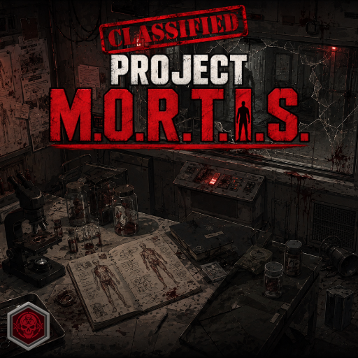

# Project M.O.R.T.I.S.

**More Original Reanimated Threats Injection System**

Project M.O.R.T.I.S. is a public custom-zombie API and framework for Project Zomboid Build 42.

- Version: `0.26.0-dev.10`
- Mod ID: `ProjectMORTIS`
- Author: B47ANCE
- Mod icon: transparent specimen jar; branded thumbnail unchanged.
- Minimum game version: `42.20.3`
- Required Mod ID: `B47ANCEDKnowledgeAndWisdom`

Project M.O.R.T.I.S. wraps vanilla `IsoZombie` instances. It does not replace the zombie class and does not add custom zombie types by itself. Extension mods own their types, spawning, presentation, and gameplay policy.

Version 0.23.0 adds the bounded `Mortis.DeathProvenance` evidence provider for
experienceWorks history records (now supplied through B47ANCEDKnowledgeAndWisdom). Callers must supply an explicit corpse, region,
stable subject identity, and matching evidence ID. MORTIS does not automatically
create memorials or decide history visibility or presentation.

## API services

- Types, traits, behaviors, components, species, and event dispatch.
- Persistent identity, authority boundaries, replication, and reconciliation.
- Authoritative assignment and clean return-to-vanilla identity for temporary extension lifecycles.
- Locomotion, durability, appearance, collision, and balance profiles.
- Anatomy, trauma channels, damage, and consequence providers.
- Canonical per-region biological material transactions plus fair, bounded,
  opt-in decomposition scheduling. Consumers own rates and target registration;
  Project M.O.R.T.I.S. never discovers targets through global scans.
- Topology-owned anatomical attachment sockets with authoritative install/remove state, persistence, replay protection, and neutral events.
- Persistent zombie hunger initialized deterministically between 0–75%, continuous starvation-duration tracking, tunable chase-drive queries, source-tagged feeding events, and extensible nearby food-source providers.
- Irreversible, years-scale desiccation advances only during full starvation,
  emits one neutral terminal event, and optionally applies verified terminal
  withering; enablement and the 1–100 year interval are sandbox configurable.
- Neutral, versioned detached-part provenance and authoritative anatomy-severing APIs for procedure mods such as medWorks.
- Weapon catalog classification and verified compatibility providers.
- Canonical native zombie knockdowns, trips, shove dominoes, stomp observation,
  pile throttling, wall-safe separation, and bounded geometry-based pile semantics.

Project Remnants is explicitly unsupported. MORTIS contains no detection,
adapter, registration, identity mapping, or compatibility path for it.
- Bounded same-floor pile observations and a property-first static-support
  registry with verified vanilla dumpster support and third-party extension API.
- Pure local pile traversal-link proposals with actor-capability and
  completion-time geometry/authority revalidation; no custom global pathfinder.
- Bounded local crowd-flow navigation.
- Server-authoritative logical groups with deterministic merge, leadership replacement, pruning, and consumer ownership.
- Capability probes, bounded rejection/capability aggregates, diagnostics
  exports, registry exports, and callback profiling without routine log spam.
- Fair, independently cursor-driven runtime batches for collision, movement
  balance, and dirty-state replication, with configurable per-pass budgets.
- Semantic API compatibility negotiation with consumer version ranges and
  required-surface type checks.
- Four physical, prerequisite-aware infected-research files registered through
  B47ANCEDKnowledgeAndWisdom cover foundational physiology, functional anatomy,
  starvation/desiccation, and physical failure modes. Project M.O.R.T.I.S. owns
  their science content while B47ANCEDKnowledgeAndWisdom owns archive/knowledge plumbing.

Physical zombie separation is enabled by default for new worlds and configurable on the `M.O.R.T.I.S. Physical Interactions` sandbox page.

## Documentation

- [Architecture and API](docs/ARCHITECTURE.md)
- [Testing](docs/TESTING.md)
- [Native trip and pile audit](docs/NATIVE_TRIP_AND_PILE_AUDIT.md)
- [Weapon compatibility](docs/WEAPON_COMPATIBILITY_POLICY.md)
- [Roadmap](docs/ROADMAP.md)

The authoritative mod source is `src/ProjectMORTIS/42/`. `Contents/mods` is a preserved packaging copy. Versions use `MAJOR.MINOR.PATCH`.

## Development validation

Root `VERSION` is canonical; see [version policy](docs/VERSION_POLICY.md) and [source inventory](SOURCE_INVENTORY.json). `Contents/` and existing `dist/` are historical local artifacts, preserved and excluded from Git.

Install Python development dependencies with `python -m pip install -r scripts/requirements.txt`, then run `python scripts/check_versions.py` and `python scripts/validate.py --knowledge-and-wisdom <B47ANCEDKnowledgeAndWisdom-repository-root>`. CI has a unit-only job plus a separate exact-input integration job for Knowledge and Nightfall. Host tests are not PZ runtime evidence: G7 BLOCKED / NOT TESTED; stable G8 BLOCKED.

For the current 0.16.0/6ba66c0 dependency candidate, add
`--dependency-evidence docs/evidence/knowledge-dependency-6ba66c0-git-bytes.json`.
This verifies all selected file hashes and the complete source inventory before
running tests; line-ending differences are failures. Other deliberately selected
dependency versions need their own reviewed input record. Without this flag the
runner records dependency input verification as false, even when integrations pass.

The authority/replication fixes and remaining limitations are described in [AUTHORITY_REPLICATION.md](docs/AUTHORITY_REPLICATION.md), with [current validation](docs/VALIDATION.md) and [GitHub onboarding provenance](docs/ONBOARDING.md). Client hunger reads no longer author state; assignment clears synchronize with stale-message protection; directed replies preserve pending broadcasts. All multiplayer peers must use the same build.

Profile removal and assignment clearing now restore saved observable locomotion fields; see [capture, legacy limits and native gates](docs/LOCOMOTION_RESTORATION.md). Dependency imports and metadata use B47ANCEDKnowledgeAndWisdom; current actual-source integration is tested against 0.16.0 with explicit SP and guarded MP-refusal coverage; see [migration and offline integration evidence](docs/DEPENDENCY_MIGRATION.md). Existing saves/server mod lists must select the new Mod ID, with only one dependency identity enabled.

## Active Hours features and standalone compatibility

B47ANCE'd Active Hours remains maintained as a standalone mod; M.O.R.T.I.S. includes its complete feature scope. The implementations are incompatible: when ProjectMORTIS is enabled, standalone Active Hours disables its own execution and MORTIS takes precedence. Neither requires the other. Included features still in design are not claimed as completed. The integrated diagnostic is dormant until explicitly started; no production day/night behavior is enabled. See [scope, preserved evidence, blockers and manual experiment](docs/ACTIVE_HOURS.md). Do not enable the old standalone proofs alongside it. G2/G6/G7/G8 retain their existing blocked/untested statuses.

Food providers now use the API 1.6.0 [transaction contract](docs/FOOD_TRANSACTIONS.md). Unsafe consume-only callbacks are never called automatically; Nightfall 0.29.1-dev.1 implements the migrated effigy adapter with actual-coordinator host tests; native consumption, persistence and replication still require validation.

Development checkpoint dev.2 hardens discovery/quarantine and rejects food values that produce no hunger relief. All 37 sandbox options now have English tooltips, checked with JSON catalog integrity by the normal offline runner; non-English fluency and native fallback remain unverified. Roadmap work has begun on an [offline weighted-range/CDF experiment](experiments/active-hours/README.md), outside the runtime/package source. See the [execution queue and remaining gates](docs/MASTER_ROADMAP.md#current-execution-queue).

Development checkpoint dev.3 extends [observed restoration to the owner stack](docs/LOCOMOTION_OVERRIDES.md): saved five-field baselines, verified cleanup, busy-state refusal and explicit recovery after owner loss. Profile writers wait while an override owns movement; release/clear owners before retrying profile or assignment changes. Full native animation/lunge restoration and MP remain unverified. See the [current audit and roadmap gates](docs/AUDIT_2026-10-16.md).

Dev.4 prepares the [runtime audit test handoff](docs/RUNTIME_AUDIT_HANDOFF.md), including dependency review, exact build records, isolated speed/owner/release proof, consumer feeding and failure/lifecycle result forms. Source work cannot close native authority/restoration gates.

## Main-menu zombie creator

The local Zombie Creator authors reusable definitions with identity, movement tier, durability, appearance and registered trait/behavior references. Save/load/delete drafts, inspect generated Lua and export a reviewed definition for a separate content mod. It works outside debug mode and does not spawn, assign or install gameplay content. [Creator guide and native test cases](docs/ZOMBIE_CREATOR.md). Native menu, focus and file behavior remain NOT TESTED.

0.26.0-dev.2 adds a [reviewed export fixture](tests/fixtures/creator_export/README.md)
and isolated Active Hours choice/phase experiments, with a
[server configuration and lifecycle proposal](docs/ACTIVE_HOURS_DESIGN.md).
They are outside runtime/package roots. Feeding coordination and Nightfall's
adapter are merged source work; native validation is next. The
[execution queue](docs/MASTER_ROADMAP.md#current-execution-queue) separates completed
offline preparation from the native authority/restoration and identity blockers.

Tests requiring an open game are human-operated. The
[human test queue](docs/HUMAN_RUNTIME_TESTS.md) records clean-client prerequisites,
creator UI/storage cases, current dependency review and the SP/dedicated order.
The normal local launcher has custom Java/loose-class contamination; no game or
server was opened, mod deployed or native PASS recorded. Knowledge & Wisdom
0.16.0 intentionally blocks affected MP storage APIs; no bypass or downgrade.

0.26.0-dev.4 adds isolated configuration normalization and exact selection keys,
the reviewed [feature overview](docs/MOD_OVERVIEW.json), and a
[read-only preflight command](docs/PREFLIGHT.md). Normal validation checks the
overview version/source digest. The [Nightfall audit](docs/NIGHTFALL_INTEGRATION_AUDIT.md)
reproduces three P1 cleanup/identity defects and a diagnostics coverage gap;
the subsequent merged Nightfall fixes have [separate source-closure evidence](docs/NIGHTFALL_INTEGRATION_CLOSURE.md). No production Active Hours options/controller
or Nightfall gameplay changes are installed by this checkpoint.

0.26.0-dev.5 closes the four Nightfall findings for corrected source with exact
merged-input regressions and optional read-only Nightfall preflight checks.
The isolated [Active Hours ownership/reconfiguration model](docs/ACTIVE_HOURS_OWNERSHIP_MODEL.md)
retains cleanup, separates release/acquire checkpoints and freezes uncertain
outcomes. It adds no runtime controller, native storage or new gameplay setting.

Combined Nightfall regression checks run separately through
`python -B scripts/check_nightfall_integration.py --knowledge-and-wisdom <exact-dependency-root> --nightfall <exact-Nightfall-root>`.
They run in the separate integration CI job. Exact merged-input evidence and the current
candidate are reported separately in the source-closure and validation documents.

0.26.0-dev.6 adds [human-result record validation](docs/RUNTIME_RESULT_FORMAT.md)
without granting native acceptance. The [installed API audit](docs/ACTIVE_HOURS_API_AUDIT.md)
records seasonal call forms, unresolved independent life identity/durable storage,
and additional loose-class mismatches. Isolated ownership fixes require checkpoint
admission for receipts/retries and reserve an outcome sequence before dispatch.
No production Active Hours adapter/controller, option or storage is installed.

Workshop test distributions use the explicit [publication procedure](docs/WORKSHOP_PUBLISHING.md)
and isolated `scripts/prepare_workshop.py` staging. A publish request authorizes
the labelled MP-testing upload to the existing item; package preparation alone
does not upload, deploy or restart Steam. G7/stable G8 remain blocked until their
required native evidence is reviewed.

Artwork checkpoint 0.26.0-dev.7 adopts the owner-supplied project thumbnail;
see [original and export provenance](assets/branding/README.md). The small UI
icon and gameplay are unchanged. No Workshop update or package was made.

0.26.0-dev.9 adds [bounded automatic hunger work](docs/HUNGER_POPULATION_SCALING.md): a fair weak FIFO under server MORTISSystems.HungerWorkPerTick (32, 1–512), with queue/actual-result/error/wait diagnostics. Time catch-up and pre-feed settlement preserve starvation across delayed work. Public API 1.6.0 and save/network schemas remain unchanged. Source/offline only; native Insane-population and dedicated performance NOT TESTED. No package/deploy/upload; G7/stable G8 BLOCKED.

Authorized matching MP-test publication preparation for 0.26.0-dev.9: see [inputs, package and human gates](docs/WORKSHOP_0.26.0-dev.9.md). Knowledge 0.17.0, MORTIS 0.26.0-dev.9 and Nightfall 0.31.0-dev.8 are the selected set. No dedicated PASS or stable approval; publication outcome is recorded separately.

Published the matching MP testing build **0.26.0-dev.9** to existing Workshop item **3788592827** on 2026-10-18. [Upload receipt and limits](docs/WORKSHOP_0.26.0-dev.9.md). G7/stable G8 remain blocked; no native multiplayer proof from distribution.
