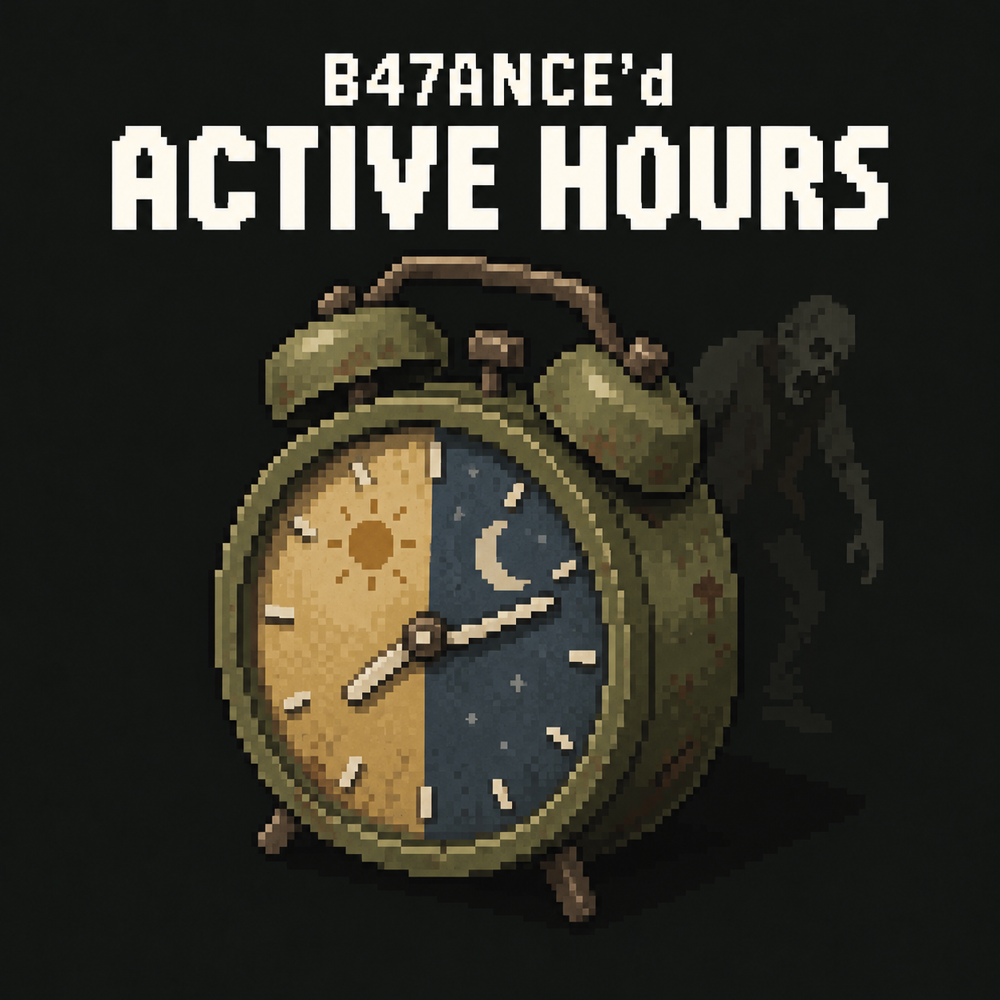

Project Version: 0.1.0-dev.4

# B47ANCE'd Active Hours

Project artwork: [thumbnail source and provenance](docs/BRANDING.md).

Mod ID: `B47ANCEDActiveHours`
Target: Project Zomboid Build 42.21
Status: isolated Lua-only experimental source prepared; production gameplay BLOCKED.

Workshop MP test item: [B47ANCE'd Active Hours](https://steamcommunity.com/sharedfiles/filedetails/?id=3820693462), version 0.1.0-dev.4. Enable diagnostic B47ANCEDActiveHoursMortisProof with ProjectMORTIS/experienceWorks, following the current MORTIS procedure. Upload/public metadata are verified; dedicated multiplayer remains NOT TESTED and stable release BLOCKED. Source/provenance is in [PR #11](https://github.com/B47ANCE/B47ANCEDActiveHours/pull/11) and docs/publications/0.1.0-dev.4-workshop-3820693462.json.

Current experiment: [Nightfall-style MORTIS speed test](docs/MORTIS_SPEED_PROOF.md), using server-side public locomotion overrides with read-only clients. Source: proof/B47ANCEDActiveHoursMortisProof/. Dependencies: ProjectMORTIS and experienceWorks. [API evidence and limitations](docs/TEAM_API_RESEARCH.md). The original owner-routed dev.3 proof/runbook below are retained historical experiments, not this variant's install instructions. No new PZ runtime success is claimed.

Active and Inactive now mean custom behavior profiles. Zombies retain native detection, pursuit and attacks. The current handoff forbids native activity access/toggles, Java interception, replacement classes, installed binary changes and sandbox mutation.

One future Workshop item contains neutral Core, Night (`B47ANCEDActiveHoursNight`) and Day (`B47ANCEDActiveHoursDay`). Gameplay modules depend on Core and are mutually exclusive. Conflict or vanilla ActiveOnly other than Both disables custom gameplay. Server owns configuration, solar thresholds and profile decisions. Client execution must follow native simulation ownership.

Current research: [Lua API audit](docs/LUA_ONLY_API_AUDIT.md), [speed feasibility](docs/LUA_SPEED_CONTROL.md), [profile architecture](docs/LUA_PROFILE_ARCHITECTURE.md), [authority](docs/LUA_MULTIPLAYER_AUTHORITY.md), [solar design](docs/SOLAR_TRANSITION_DESIGN.md), [minimal proof](docs/LUA_ONE_ZOMBIE_POC.md), [blockers](docs/RELEASE_BLOCKERS.md), [test plan](docs/TEST_PLAN.md), [configuration](docs/CONFIGURATION_GUIDE.md), [performance](docs/PERFORMANCE_DESIGN.md).

Public category methods are source-supported Lua candidates, not runtime-verified gameplay controls. Global Speed readers, derived-state restoration and owner/network ordering remain blockers. The first conditional proof is one standing continuously loaded zombie, fixed speed, dedicated server and two clients. Solar and additional attributes are deferred.

G2 Lua architecture BLOCKED; Phase B executable Lua speed proof NOT STARTED; G6 NOT TESTED; G7 BLOCKED / NOT TESTED; G8 BLOCKED. Isolated experimental source is now prepared; no PZ runtime execution, game/server launch, deployment, package or release occurred.

[Retained validation](docs/VALIDATION.md), attribute call graphs and native ownership evidence remain source research. Native bridge and old native proof designs are explicitly superseded. Local engine extractions/decompilation are inspection artifacts, never distribution assets. External loose-class drift is recorded; actual effective peer behavior is UNKNOWN.

Approved initial project version is recorded in root VERSION. See docs/VERSION_POLICY.md and docs/VERSION_INVENTORY.md. Historical game/tool versions are separate. No release artifacts exist; gameplay remains blocked.

Prepared isolated experiment: [installation, operator controls and dedicated matrix](docs/ISOLATED_SPEED_PROOF.md). Source under proof/ uses a distinct diagnostic Mod ID; production Core/Night/Day remain absent. Thirty-six actual-Lua mock tests per Lua 5.1/5.4 engine are offline only. Runtime gates stay unchanged.

Current checkpoint adds readiness fixes; G2 blocks production approval and does not block isolated prototype validation. Follow docs/ISOLATED_SPEED_PROOF.md for human installation and three-peer procedure; no automatic deployment/launch.

Final human preparation: [disposable test runbook](docs/RUNTIME_TEST_RUNBOOK.md) and [blank runtime evidence form](docs/RUNTIME_EVIDENCE_TEMPLATE.md). Prototype code is unchanged by this documentation-only handoff; runtime evidence remains pending.
